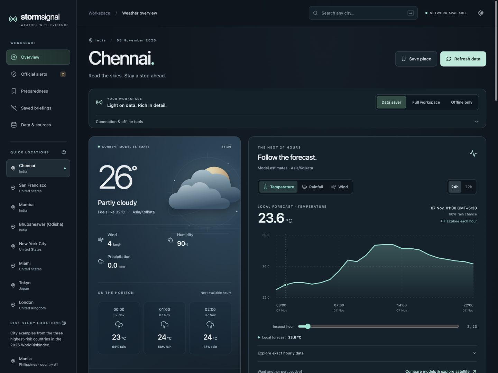

# StormSignal

[Open the live website](https://stormsignal-weather.pages.dev) · [Verification notes](docs/verification.md)

Weather with evidence. A weather workspace that puts forecasts, satellite imagery, model disagreement, and official warning coverage in one view.

StormSignal is intended for public situational awareness and learning. It does not issue official warnings, certify safe routes, or replace emergency instructions. No data is not the same as no danger.

## Frontend showcase

A React + TypeScript dashboard for exploring weather evidence, with custom SVG graphics, responsive layouts and explicit loading, missing-data and offline states.



- **Explore the forecast:** inspect individual hours with a pointer or keyboard, switch temperature/rainfall/wind, and compare available time ranges. The SVG chart preserves missing-data gaps and has an exact-value table. Data saver uses the forecast already loaded; model comparisons and map downloads remain optional.
- **Export a comparison:** download the displayed metric as CSV with UTC timestamps, units, and model columns aligned by timestamp. Missing values stay blank. The 24/72-hour ranges measure elapsed time even when a provider omits observations.
- **Inspect the visual implementation:** [ForecastExplorer](src/components/ForecastExplorer.tsx), [AtmosphereScene](src/components/AtmosphereScene.tsx) and the [frontend design styles](src/frontend-design.css) separate interactive data graphics, decorative atmosphere artwork and presentation. The artwork is an illustration, not radar or a satellite observation.
- **Review the engineering:** follow the [UI case study and acceptance checklist](docs/ui-case-study.md), then the [dated verification record](docs/verification.md). The checklist states expected behavior; historical test results apply to their recorded release, not every later commit.

## Run locally

Use **Node.js 22.12+**. The repository's `.nvmrc` selects Node 22; run `nvm use` if you use nvm. No API key or environment file is required for the current public-data integrations.

```sh
npm ci
npm run dev
```

Open the URL printed by Vite. New forecasts, warning checks and map tiles require internet access. Start in **Data saver**, then open **Full workspace** for maps, satellite imagery, model comparison and regional reports.

```sh
npm run check      # unit tests, TypeScript, production build and artifact checks
npm run preview    # serve the built application and warning API locally
npm run test:live  # optional real-provider warning checks; run after a build
npm run test:live -- --base-url=https://stormsignal-weather.pages.dev # hosted API
```

`npm test`, `npm run typecheck` and `npm run build` are also available individually. CI installs from the lockfile and runs `npm run check` on Node 22. Tests use fixtures and mocks where appropriate; live-provider checks are separate because network access and upstream data can change.

## Reviewer tour

| Evidence                                                        | Where to look                                                                                                                   |
| --------------------------------------------------------------- | ------------------------------------------------------------------------------------------------------------------------------- |
| Interactive SVG, keyboard hour selection and exact-value tables | [ForecastExplorer](src/components/ForecastExplorer.tsx), [chart geometry](src/forecast-chart.ts)                                |
| Visual identity and responsive layout                           | [AtmosphereScene](src/components/AtmosphereScene.tsx), [design styles](src/frontend-design.css)                                 |
| Loading, refresh failures, focus and local persistence          | [App](src/App.tsx), [resource state](src/resource.ts), [focus handling](src/focus-trap.ts), [offline briefings](src/offline.ts) |
| Provider contracts and defensive parsing                        | [data adapters](src/data.ts), [warning gateway](server/router.ts), [tests](tests/)                                              |
| Observable acceptance criteria and recorded results             | [UI case study](docs/ui-case-study.md), [verification record](docs/verification.md)                                             |

Historical test results apply to the recorded version. Use the commands above and the acceptance checklist to review a new checkout. Passing tests does not guarantee provider availability, accurate forecasts or complete warning coverage.

## Product behavior

- **Find and compare places:** worldwide search, saved places and regional shortcuts. Forecast coverage is separate from official-warning coverage.
- **Inspect evidence:** hourly graphics, timestamped satellite layers and two-model comparison. Decorative artwork stays separate from data graphics; model disagreement is not a calibrated probability.
- **Understand warning scope:** NWS, NDMA SACHET, participating WMO authorities and bounded national feeds retain source links, affected areas and unavailable-source states.
- **Control downloads:** Data saver starts with a compact forecast and supported warnings. Optional imagery, maps and reports load in Full workspace; Data saver does not poll.
- **Prepare for disconnection:** save up to three dated briefings or download the self-contained offline field kit at `/offline.html`. Historical copies never claim current warning status.
- **Keep data local:** no account or app analytics. Browser storage holds preferences and saved content; providers receive requests. See [privacy](docs/privacy.md).

City search supports arrow keys, Enter and Escape. Mobile navigation contains focus while open, closes with Escape and restores focus to its opener. The production service worker caches the essential interface after a successful online installation. First-ever offline visits and browser storage eviction remain limitations; keep a downloaded or printed kit. **Offline only** pauses weather-provider requests and online search, but does not prevent browser or service-worker update checks.

See [architecture and detailed behavior](docs/architecture.md), [offline preparation](docs/offline.md), [data sources](docs/data-sources.md) and [deployment instructions](docs/deployment.md). `npm run build` creates `pages-dist/` for Cloudflare Pages and `dist/` for local production preview. A Git push alone does not publish the website.

## Coverage and limits

| Feature                               | Coverage                                                                                                            | Important limit                                                                                                                                                                                                                                                                                             |
| ------------------------------------- | ------------------------------------------------------------------------------------------------------------------- | ----------------------------------------------------------------------------------------------------------------------------------------------------------------------------------------------------------------------------------------------------------------------------------------------------------- |
| Forecasts and model comparison        | Global forecast grids via Open-Meteo                                                                                | Modeled estimates, not local instrument observations; resolution and update times vary.                                                                                                                                                                                                                     |
| Air quality                           | CAMS model output via Open-Meteo                                                                                    | Regional/global grid estimates; not a street-level air sensor.                                                                                                                                                                                                                                              |
| Near-real-time satellite              | Supported geostationary viewing areas                                                                               | Capture delay, limb distortion, missing frames and viewing limits apply.                                                                                                                                                                                                                                    |
| Daily true-color satellite            | Global NASA GIBS product                                                                                            | Clouds, polar night, orbital gaps and processing delays affect availability.                                                                                                                                                                                                                                |
| In-app official warnings              | US NWS; direct PAGASA, BMKG and IMD Kolkata feeds; Indian regional SACHET feeds; participating WMO SWIC authorities | Global coverage is incomplete. Indian SACHET feeds are regional, not city-specific; Kolkata also gets IMD's district nowcast. Up to 20 direct PAGASA/BMKG documents, 10 Indian SACHET entries or 6 WMO source documents are checked; missing/unmapped feeds and invalid or absent expiry can omit warnings. |
| Regional disaster reports             | Retrieved GDACS cyclone, flood and wildfire reports                                                                 | Recent reports, not a complete global warning feed; 200-record retrieval cap and representative-point distance limits apply.                                                                                                                                                                                |
| Offline field kit and saved briefings | General preparation and explicitly saved, dated local copies                                                        | No new warnings offline. Local authorities' current instructions take precedence. No live shelter or evacuation routing.                                                                                                                                                                                    |

See [data sources and licensing](docs/data-sources.md) and [imagery details](docs/imagery.md). The app cannot guarantee notification delivery, availability, or detection of every hazard. Do not rely on it as your only warning channel.

## Contributing

See [CONTRIBUTING.md](CONTRIBUTING.md). Improvements to alert coverage, accessibility, provider resilience and documented verification are especially useful. Please include evidence for data and safety claims. Work is published using real commit times and attributable source changes; third-party notices must be preserved.

## License

Original application code is available under the [MIT license](LICENSE). Weather data, imagery, map tiles, provider names and third-party libraries retain their respective terms and attribution requirements. MIT licensing of the code is not a redistribution license for every displayed dataset.

Release builds include `/third-party-licenses.md` for both the browser bundles and the warning gateway, including their emitted transitive dependencies. The gateway notice is derived from the bundle metadata and installed package licenses; the upstream MIT notice omitted from the published `@nodable/entities@3.1.0` package is preserved under `scripts/licenses/`.

## GitHub resource collection

Explore the project-specific [resource catalog](resources/README.md): curated references, star-ranked discovery, dated source metadata, cached failure recovery and an optional read-only server API. The daily refresh workflow updates the public catalog. The resource library reads the latest GitHub snapshot with a bundled offline fallback; application-code updates still follow the existing deployment process.

The web resource library now checks for fresh public metadata every 15 minutes while an app tab is open and saves the latest validated collection for offline visits. It shows successful-check and source-observation dates separately, preserves good data during failures, and keeps its offline storage separate from application progress. See [resource update and offline behavior](resources/README.md#automatic-checks-and-offline-collections-in-the-web-app).
