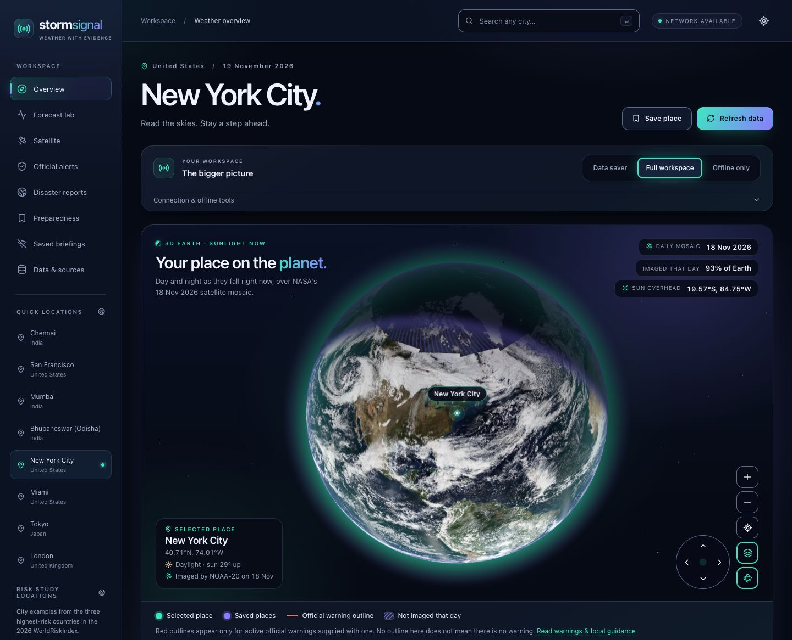

# StormSignal

[](https://github.com/TARUNTEjjjj/stormsignal/actions/workflows/ci.yml)
[](https://github.com/TARUNTEjjjj/stormsignal/actions/workflows/resources.yml)
[](https://nodejs.org/)
[](https://www.typescriptlang.org/)
[](https://react.dev/)
[](LICENSE)

[Open the live website](https://stormsignal-weather.pages.dev) · [Verification notes](docs/verification.md)

Weather with evidence. A weather workspace that puts forecasts, satellite imagery, model disagreement, and official warning coverage in one view.

StormSignal is intended for public situational awareness and learning. It does not issue official warnings, certify safe routes, or replace emergency instructions. No data is not the same as no danger.

## Frontend showcase

A React + TypeScript dashboard for exploring weather evidence, with an interactive three.js globe, custom SVG graphics, responsive layouts and explicit loading, missing-data and offline states.



- **Explore the forecast:** inspect individual hours with a pointer or keyboard, switch temperature/precipitation/wind, and compare available time ranges. The SVG chart preserves missing-data gaps and has an exact-value table. Data saver uses the forecast already loaded; model comparisons and map downloads remain optional.
- **Export a comparison:** download the displayed metric as CSV with UTC timestamps, units, and model columns aligned by timestamp. Missing values stay blank. The 24/72-hour ranges measure elapsed time even when a provider omits observations.
- **Turn the planet:** in Full workspace, an interactive 3D globe ([GlobeView](src/components/GlobeView.tsx), three.js) shows NASA's newest daily VIIRS mosaic whose UTC day has ended over the Blue Marble base, with its date and the share of Earth it covers. When that mosaic is still partial, the globe shows the day before, says so and looks again hourly; a failed look keeps the dated mosaic on show and says the check failed. Areas a mosaic did not image are hatched, and the place card says whether the selected place was imaged, so a cloud-free map never passes for clear weather. Day and night are computed from the sun's position at the current UTC time, read on the warning service's clock once a check has measured it, so the terminator needs no request; the night side is drawn dark. The selected place pulses, saved places and active official warning outlines are marked, active warnings are one click away, and a click or tap selects a point as the map does. Arrow keys or the on-screen rotate pad turn the globe, + and − zoom, Enter selects the point you turned to, Home returns to the place and Escape hides the key help. The globe turns by itself for a minute after it starts, then glides back to the selected place and rests there; a drag or a key stops it sooner, and the Globe motion switch turns off everything it does by itself. An idle globe stops drawing, and with reduced motion nothing moves on its own. Data saver and Offline only never download the globe or its imagery; browsers without WebGL 2 never download three.js and get a short notice instead of the globe.
- **Inspect the visual implementation:** [ForecastExplorer](src/components/ForecastExplorer.tsx), [AtmosphereScene](src/components/AtmosphereScene.tsx) and the [frontend design styles](src/frontend-design.css) separate interactive data graphics, decorative atmosphere artwork and presentation. The artwork is an illustration, not radar or a satellite observation.
- **Review the engineering:** follow the [UI case study and acceptance checklist](docs/ui-case-study.md), then the [dated verification record](docs/verification.md). The checklist states expected behavior; historical test results apply to their recorded release, not every later commit.

## Run locally

Use **Node.js 22.12+**. The repository's `.nvmrc` selects Node 22; run `nvm use` if you use nvm. No API key or environment file is required for the current public-data integrations.

```sh
npm ci
npm run dev
```

Open the URL printed by Vite. New forecasts, warning checks and map tiles require internet access. Start in **Data saver**, then open **Full workspace** for the 3D globe, maps, satellite imagery, model comparison and regional reports.

```sh
npm run check      # unit tests, TypeScript, production build and artifact checks
npm run preview    # serve the built application and warning API locally
npm run test:live  # optional real-provider warning checks; run after a build
npm run test:live -- --base-url=https://stormsignal-weather.pages.dev # hosted API
```

`npm test`, `npm run typecheck` and `npm run build` are also available individually. CI installs from the lockfile and runs `npm run format:check` and `npm run check` on Node 22; `npm run format` fixes formatting. Tests use fixtures and mocks where appropriate; live-provider checks are separate because network access and upstream data can change.

## Reviewer tour

| Evidence                                                        | Where to look                                                                                                                   |
| --------------------------------------------------------------- | ------------------------------------------------------------------------------------------------------------------------------- |
| Interactive SVG, keyboard hour selection and exact-value tables | [ForecastExplorer](src/components/ForecastExplorer.tsx), [chart geometry](src/forecast-chart.ts)                                |
| Visual identity and responsive layout                           | [AtmosphereScene](src/components/AtmosphereScene.tsx), [design styles](src/frontend-design.css)                                 |
| Loading, refresh failures, focus and local persistence          | [App](src/App.tsx), [resource state](src/resource.ts), [focus handling](src/focus-trap.ts), [offline briefings](src/offline.ts) |
| Provider contracts and defensive parsing                        | [data adapters](src/data.ts), [warning gateway](server/router.ts), [tests](tests/)                                              |
| Observable acceptance criteria and recorded results             | [UI case study](docs/ui-case-study.md), [verification record](docs/verification.md)                                             |

Historical test results apply to the recorded version. Use the commands above and the acceptance checklist to review a new checkout. Passing tests does not guarantee provider availability, accurate forecasts or complete warning coverage.

## Product behavior

- **Find and compare places:** worldwide search, saved places and regional shortcuts. Forecast coverage is separate from official-warning coverage.
- **Inspect evidence:** hourly graphics, timestamped satellite layers and two-model comparison. Decorative artwork stays separate from data graphics; model disagreement is not a calibrated probability.
- **Understand warning scope:** NWS, NDMA SACHET, participating WMO authorities and bounded national feeds retain source links, affected areas and unavailable-source states.
- **Control downloads:** Data saver starts with a compact forecast and supported warnings. Optional imagery, maps, the 3D globe and reports load in Full workspace; Data saver does not poll.
- **Prepare for disconnection:** save up to three dated briefings or download the self-contained offline field kit at `/offline.html`. Historical copies never claim current warning status.
- **Keep data local:** no account or app analytics. Browser storage holds preferences and saved content; providers receive requests. See [privacy](docs/privacy.md).

City search supports arrow keys, Enter and Escape. Mobile navigation contains focus while open, closes with Escape and restores focus to its opener. The production service worker caches the essential interface after a successful online installation. First-ever offline visits and browser storage eviction remain limitations; keep a downloaded or printed kit. **Offline only** pauses weather-provider requests and online search, but does not prevent browser or service-worker update checks.

See [architecture and detailed behavior](docs/architecture.md), [offline preparation](docs/offline.md), [data sources](docs/data-sources.md) and [deployment instructions](docs/deployment.md). `npm run build` creates `pages-dist/` for Cloudflare Pages and `dist/` for local production preview. A Git push alone does not publish the website.

## Coverage and limits

| Feature                               | Coverage                                                                                                            | Important limit                                                                                                                                                                                                                                                                                             |
| ------------------------------------- | ------------------------------------------------------------------------------------------------------------------- | ----------------------------------------------------------------------------------------------------------------------------------------------------------------------------------------------------------------------------------------------------------------------------------------------------------- |
| Forecasts and model comparison        | Global forecast grids via Open-Meteo                                                                                | Modeled estimates, not local instrument observations; resolution and update times vary.                                                                                                                                                                                                                     |
| Air quality                           | CAMS model output via Open-Meteo                                                                                    | Regional/global grid estimates; not a street-level air sensor.                                                                                                                                                                                                                                              |
| Near-real-time satellite              | Supported geostationary viewing areas                                                                               | Capture delay, limb distortion, missing frames and viewing limits apply.                                                                                                                                                                                                                                    |
| Daily true-color satellite            | Global NASA GIBS product                                                                                            | Clouds, polar night, orbital gaps and processing delays affect availability.                                                                                                                                                                                                                                |
| In-app official warnings              | US NWS; direct PAGASA, BMKG and IMD Kolkata feeds; Indian regional SACHET feeds; participating WMO SWIC authorities | Global coverage is incomplete. Indian SACHET feeds are regional, not city-specific; Kolkata also gets IMD's district nowcast. Up to 20 direct PAGASA/BMKG documents, 10 Indian SACHET entries or 6 WMO source documents are checked; missing/unmapped feeds and invalid or absent expiry can omit warnings. |
| Regional disaster reports             | Retrieved GDACS cyclone, flood and wildfire reports                                                                 | Recent reports, not a complete global warning feed; 200-record retrieval cap and representative-point distance limits apply.                                                                                                                                                                                |
| Offline field kit and saved briefings | General preparation and explicitly saved, dated local copies                                                        | No new warnings offline. Local authorities' current instructions take precedence. No live shelter or evacuation routing.                                                                                                                                                                                    |

See [data sources and licensing](docs/data-sources.md) and [imagery details](docs/imagery.md). The app cannot guarantee notification delivery, availability, or detection of every hazard. Do not rely on it as your only warning channel.

## Contributing

See [CONTRIBUTING.md](CONTRIBUTING.md). Improvements to alert coverage, accessibility, provider resilience and documented verification are especially useful. Please include evidence for data and safety claims. Work is published using real commit times and attributable source changes; third-party notices must be preserved.

## License

Original application code is available under the [MIT license](LICENSE). Weather data, imagery, map tiles, provider names and third-party libraries retain their respective terms and attribution requirements. MIT licensing of the code is not a redistribution license for every displayed dataset.

Release builds include `/third-party-licenses.md` for both the browser bundles and the warning gateway, including their emitted transitive dependencies. The gateway notice is derived from the bundle metadata and installed package licenses; the upstream MIT notice omitted from the published `@nodable/entities@3.1.0` package is preserved under `scripts/licenses/`.

## GitHub resource collection

Explore the project-specific [resource catalog](resources/README.md): curated references, star-ranked discovery, dated source metadata, cached failure recovery and an optional read-only server API. The daily refresh workflow updates the public catalog. The resource library reads the latest GitHub snapshot with a bundled offline fallback; application-code updates still follow the existing deployment process.

The web resource library now checks for fresh public metadata every 15 minutes while it is open, or while the dashboard is open in Full workspace with a connection, and saves the latest validated collection for offline visits. It shows successful-check and source-observation dates separately, preserves good data during failures, and keeps its offline storage separate from application progress. See [resource update and offline behavior](resources/README.md#automatic-checks-and-offline-collections-in-the-web-app).
