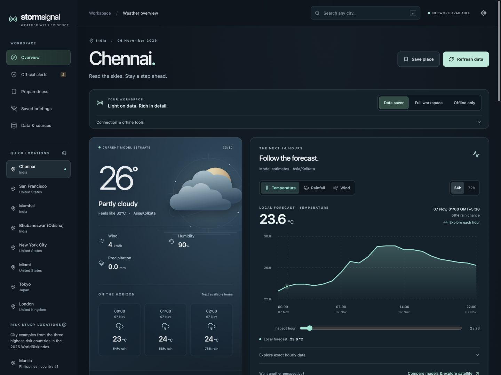

# StormSignal: frontend case study

StormSignal combines forecasts, imagery, official-warning coverage and saved offline briefings. Its interface must make those different kinds of evidence understandable without hiding missing data or suggesting that an empty warning feed proves safety.

This iteration focuses on visual hierarchy and hands-on exploration in React and TypeScript. It builds on the existing forecast adapters, warning gateway, Leaflet map and offline workflow.

## The design problem

The earlier dashboard had a broad feature set, a simple forecast line chart and separate compact/full-workspace views. A reviewer had to discover the richer tools before seeing much of the frontend work. A more polished first view should help any visitor understand current conditions and explore the forecast, while retaining the low-bandwidth default.

The updated direction uses a clearer conditions summary, consistent surface and type hierarchy, atmosphere artwork and a dedicated forecast explorer. Graphics serve distinct purposes: the forecast chart encodes retrieved numbers; the atmosphere scene supplies visual identity. The scene is decorative and must not be interpreted as a radar return, warning boundary or satellite capture.

## Implementation tour

| Area                         | Source                                                                                                       | Review focus                                                                               |
| ---------------------------- | ------------------------------------------------------------------------------------------------------------ | ------------------------------------------------------------------------------------------ |
| Forecast exploration         | [`ForecastExplorer.tsx`](../src/components/ForecastExplorer.tsx)                                             | Metric and range state, hour selection, SVG plotting and exact-value alternatives          |
| Atmosphere artwork           | [`AtmosphereScene.tsx`](../src/components/AtmosphereScene.tsx)                                               | A reusable graphical component kept separate from measured weather evidence                |
| Visual system                | [`frontend-design.css`](../src/frontend-design.css)                                                          | Surfaces, typography, responsive composition, focus and motion treatment                   |
| Application integration      | [`App.tsx`](../src/App.tsx)                                                                                  | Selected place, connection policy, data loading and optional panels                        |
| Chart geometry               | [`forecast-chart.ts`](../src/forecast-chart.ts), [`forecast-chart.test.ts`](../tests/forecast-chart.test.ts) | Time-aligned model series, discontinuities, scales and pointer selection                   |
| Focus and refresh behavior   | [`focus-trap.ts`](../src/focus-trap.ts), [`resource.ts`](../src/resource.ts)                                 | Drawer focus recovery and retention of the last successful result during refresh failures  |
| Presentation helpers         | [`presentation.ts`](../src/presentation.ts)                                                                  | Finite-number formatting, timezone labels and paths that break at missing values           |
| Forecast contracts           | [`types.ts`](../src/types.ts), [`data.ts`](../src/data.ts)                                                   | Typed provider data, normalization and bounded network behavior                            |
| Existing regression examples | [`presentation.test.ts`](../tests/presentation.test.ts)                                                      | Missing values, chart gaps, comparable model timestamps and repeated daylight-saving hours |

### Interaction choices

- **Inspect an hour:** pointer and keyboard controls expose an individual forecast time and its values. The text/table alternative remains useful when the graph is difficult to read or operate.
- **Switch the question:** temperature, rainfall and wind share a consistent interaction model, with units changing alongside the metric. A requested range cannot create hours absent from the retrieved forecast.
- **Preserve uncertainty:** missing readings remain missing. Paths break across gaps; unavailable values are not silently plotted as zero. Two-model disagreement is not a probability or confidence interval.
- **Keep the compact path useful:** Data saver presents the local forecast already fetched. It does not need a map, satellite tiles or comparison-model requests to show the chart.
- **Retain the broader workflow:** Full workspace enables optional evidence tools. Offline only keeps saved, dated briefings distinct from current conditions.

### Accessibility and responsive review

The interface should remain understandable through headings, labelled controls, visible focus and text values as well as color and shapes. Review keyboard operation and focus recovery for city search and the mobile drawer. Verify the new graphics with reduced motion enabled, and keep decorative artwork out of the meaningful data reading order. These are review requirements, not a substitute for testing with assistive technology and real users.

## Objective reviewer checklist

Run `npm ci` and `npm run check`, then use `npm run preview` for a production-artifact review. Record the commit, viewport, browser, connection mode, selected location and date of each check. Live provider results vary; deterministic checks should use fixtures rather than expecting a particular real-world temperature or warning count.

| Flow              | Action                                                                | Observable success criterion                                                                                           |
| ----------------- | --------------------------------------------------------------------- | ---------------------------------------------------------------------------------------------------------------------- |
| First view        | Open a fresh session in Data saver                                    | Current/forecast loading is explicit; the forecast explorer appears when data arrives without requiring Full workspace |
| Metric selection  | Switch temperature → rainfall → wind                                  | Selected control, displayed values, graph scale and units agree with the selected metric                               |
| Hour inspection   | Inspect the same hour using pointer and keyboard                      | Both paths expose the same timestamp and numbers; the exact-value table agrees                                         |
| Range selection   | Change the offered duration                                           | The chart uses the available subset for that range; it does not invent points beyond the retrieved data                |
| Missing data      | Supply a forecast with a missing interior reading                     | A visible gap replaces the missing segment; the corresponding value remains unavailable, not zero                      |
| Keyboard workflow | Search for a city, choose with arrows/Enter, then dismiss with Escape | Selection updates the place; search state and focus remain usable without a pointer                                    |
| Mobile drawer     | Open navigation, move focus, press Escape                             | Focus stays within the open drawer, then returns to its opener when closed                                             |
| Responsive layout | Inspect desktop and a 390 × 844 viewport                              | Controls remain reachable, text stays readable and no page-level horizontal overflow appears                           |
| Reduced motion    | Enable the operating-system/browser preference                        | Nonessential animation is suppressed; data and controls remain available                                               |
| Location change   | Change city while a request is still pending                          | A late response from the previous city cannot replace the selected city's data                                         |
| Provider failure  | Review unavailable forecast and warning-source states                 | Failure remains visible and actionable; no fabricated measurement or all-clear appears                                 |
| Offline briefing  | Save a briefing, then select Offline only                             | The saved date and current-status-unknown treatment remain visible; historical values do not look live                 |
| Network budget    | Inspect Data saver network requests                                   | Forecast exploration itself adds no comparison-model, map-tile or satellite requests                                   |

## Evidence and limits

Use the repository's [verification record](verification.md) for observed results and their dates. The checklist above describes what to verify and does not claim that every check has passed for this iteration. Screenshot evidence shows a specific build and data snapshot; it does not establish current weather conditions or ongoing provider availability.

Earlier verification sections are historical release records. Their test totals, supported regions and known limitations describe the versions reviewed at that time. Consult the current [coverage documentation](../README.md#coverage-and-limits) and source code for the present implementation.

The project history should remain attributable to work actually completed, with real timestamps, focused changes and preserved third-party notices. A polished interface is evidence reviewers can inspect; it does not replace a record of verifiable code contributions.
